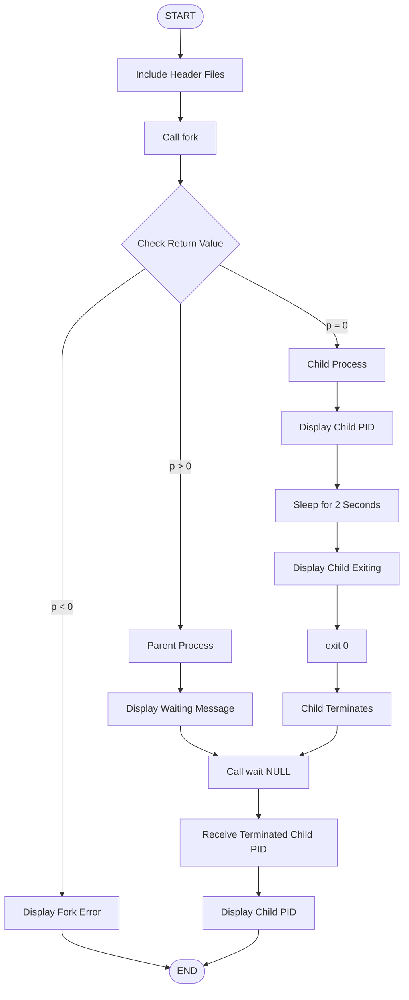

# 🚀 EXPERIMENT 10 — PROCESS CREATION AND TERMINATION USING C

<p align="center">
  
</p>

<p align="center">
  
  
  
  
</p>

<p align="center">
  <b>OPERATING SYSTEMS LABORATORY</b><br>
  <i>Understanding Linux Process Management Through C Programming</i>
</p>

---

## 📌 ABOUT THE EXPERIMENT

This experiment demonstrates the creation and termination of processes in the Linux operating system using C programming.

It explains how a parent process creates a child process using the `fork()` system call, how the child performs its execution, and how the parent waits for the child to terminate using `wait()`.

The program also demonstrates process identification using `getpid()`, execution delay using `sleep()`, and process termination using `exit()`.

### ⚡ Key Concepts

- Process Creation
- Parent and Child Processes
- Process Identification (PID)
- Process Synchronization
- Process Termination
- Linux System Calls

---

## 📑 TABLE OF CONTENTS

| No. | Topic |
|:---:|---|
| 01 | [Aim](#-01-aim) |
| 02 | [Objectives](#-02-objectives) |
| 03 | [Software Requirements](#-03-software-requirements) |
| 04 | [Theory](#-04-theory) |
| 05 | [System Calls Used](#-05-system-calls-used) |
| 06 | [Program Code](#-06-program-code) |
| 07 | [Program Explanation](#-07-program-explanation) |
| 08 | [Algorithm](#-08-algorithm) |
| 09 | [Compilation and Execution](#-09-compilation-and-execution) |
| 10 | [Screenshots](#-10-execution-screenshots) |
| 11 | [Output and Explanation](#-11-output-and-explanation) |
| 12 | [Process Execution Flowchart](#-12-process-execution-flowchart) |
| 13 | [Important Observations](#-13-important-observations) |
| 14 | [Precautions](#-14-precautions) |
| 15 | [Result](#-15-result) |

---

## 🎯 01. AIM

To write and execute a C program that creates a child process using the `fork()` system call, waits for its termination using `wait()`, and displays the Process ID (PID) of the terminated child process.

---

## 🎯 02. OBJECTIVES

The main objectives of this experiment are:

1. To understand the concept of process creation in Linux.
2. To create a child process using the `fork()` system call.
3. To understand the difference between parent and child processes.
4. To use the `wait()` system call to synchronize parent and child processes.
5. To display the Process ID (PID) of the child process.
6. To understand process termination using `exit()`.
7. To understand how Linux manages multiple processes during program execution.

---

## 💻 03. SOFTWARE REQUIREMENTS

The following software and tools are required to perform this experiment.

| Component | Specification |
|---|---|
| Operating System | Ubuntu Linux |
| Virtualization Software | Oracle VirtualBox |
| Programming Language | C |
| Compiler | GCC |
| Text Editor | GNU Nano |
| Terminal | Linux Terminal |
| File Extension | `.c` |

---

## 📚 04. THEORY

### What is a Process?

A process is a program that is currently being executed by the operating system.

Every process has a unique Process ID (PID), which helps the operating system identify and manage it.

A process requires system resources such as CPU time, memory and other resources during execution.

### What is Process Creation?

Process creation is the process of creating a new process during program execution.

In Linux, a process can create another process using the `fork()` system call.

The process that creates another process is called the **Parent Process**, while the newly created process is called the **Child Process**.

### Parent Process

A parent process is the original process that creates another process using `fork()`.

### Child Process

A child process is a newly created process that executes independently from its parent process.

### Process ID (PID)

A Process ID is a unique numerical identifier assigned to each process by the operating system.

It is used to identify and manage processes.

### Process Synchronization

Process synchronization is the coordination of multiple processes to ensure that they execute in the required order.

In this experiment, the `wait()` system call makes the parent process wait until its child process terminates.

---

## ⚙️ 05. SYSTEM CALLS USED

This experiment uses five important Linux functions.

| Function | Purpose |
|---|---|
| `fork()` | Creates a new child process. |
| `getpid()` | Returns the PID of the currently executing process. |
| `sleep()` | Suspends execution for a specified number of seconds. |
| `wait()` | Makes the parent wait for a child process to terminate. |
| `exit()` | Terminates the calling process. |

### 1. fork()

The `fork()` system call creates a new child process.

**Return values:**

- `0` – Returned to the child process.
- Positive value – Returns the child's PID to the parent.
- `-1` – Indicates process creation failure.

### 2. getpid()

The `getpid()` function returns the Process ID of the currently executing process.

It helps identify the child process.

### 3. sleep()

The `sleep()` function suspends the execution of the calling process for a specified number of seconds.

In this experiment:

```c
sleep(2);
```

The child process pauses for two seconds.

### 4. wait()

The `wait()` system call makes the parent process wait until one of its child processes terminates.

It returns the PID of the terminated child process.

It also collects the child's termination status, preventing the terminated child from remaining as a zombie process.

### 5. exit()

The `exit()` function terminates the calling process.

```c
exit(0);
```

Here, `0` indicates successful termination.

---

## 💻 06. PROGRAM CODE

**File Name:** `pidcomplete.c`

The following C program demonstrates process creation, synchronization and termination using Linux system calls.

```c
#include <stdio.h>
#include <stdlib.h>
#include <unistd.h>
#include <sys/wait.h>

int main() {

    pid_t p = fork();

    if (p < 0) {
        perror("Fork failed");
        return 1;
    }

    if (p == 0) {

        printf("Child Running with PID: %d\n", getpid());

        sleep(2);

        printf("Child Exiting...\n");

        exit(0);
    }
    else {

        printf("Parent Waiting for child to terminate...\n");

        pid_t terminated_pid = wait(NULL);

        if (terminated_pid == -1) {
            perror("Wait failed");
            return 1;
        }

        printf("Parent Terminated Child PID: %d\n",
               terminated_pid);
    }

    return 0;
}
```

### Header Files Used

| Header File | Description |
|---|---|
| `stdio.h` | Provides input and output functions such as `printf()` and `perror()`. |
| `stdlib.h` | Provides the `exit()` function. |
| `unistd.h` | Provides `fork()`, `getpid()` and `sleep()`. |
| `sys/wait.h` | Provides the `wait()` system call declaration. |

---

## 🔍 07. PROGRAM EXPLANATION

### Step 1: Include Header Files

```c
#include <stdio.h>
#include <stdlib.h>
#include <unistd.h>
#include <sys/wait.h>
```

These header files provide the functions required for input/output, process creation, process termination and synchronization.

### Step 2: Create a Child Process

```c
pid_t p = fork();
```

The `fork()` system call creates a new child process.

After successful execution, both parent and child processes continue executing from the statement following `fork()`.

### Step 3: Check Process Creation Failure

```c
if (p < 0) {
    perror("Fork failed");
    return 1;
}
```

If `fork()` returns `-1`, it means that the child process could not be created.

The program displays an error message and terminates.

### Step 4: Execute the Child Process

```c
if (p == 0) {

    printf("Child Running with PID: %d\n", getpid());

    sleep(2);

    printf("Child Exiting...\n");

    exit(0);
}
```

When the return value of `fork()` is zero, the child process executes this block.

- Displays the child's PID using `getpid()`.
- Waits for two seconds using `sleep(2)`.
- Displays the child exiting message.
- Terminates successfully using `exit(0)`.

### Step 5: Execute the Parent Process

```c
else {

    printf("Parent Waiting for child to terminate...\n");

    pid_t terminated_pid = wait(NULL);
}
```

The parent process executes this block.

- Displays a waiting message.
- Calls `wait(NULL)` to wait for the child process.
- Receives the PID of the terminated child process.

### Step 6: Display the Terminated Child PID

```c
printf("Parent Terminated Child PID: %d\n",
       terminated_pid);
```

This statement displays the PID returned by the `wait()` system call.

The PID matches the PID displayed by the child process.

### Step 7: Terminate the Parent Process

```c
return 0;
```

The parent process terminates successfully after the child process has completed its execution.

---

## 📝 08. ALGORITHM

1. Start the program.
2. Include the required header files.
3. Declare a process ID variable.
4. Call the `fork()` system call to create a child process.
5. Check the return value of `fork()`.
6. If the return value is negative, display an error message.
7. If the return value is zero:
   - Display the child process PID.
   - Suspend execution for two seconds.
   - Display the child exiting message.
   - Terminate the child using `exit(0)`.
8. Otherwise, execute the parent process:
   - Display the waiting message.
   - Call `wait(NULL)` to wait for the child.
   - Store the terminated child's PID.
   - Display the terminated child's PID.
9. End the program.

---

## ▶️ 09. COMPILATION AND EXECUTION

Follow these steps to compile and execute the C program in Ubuntu Linux using Oracle VirtualBox.

### Step 1: Open Ubuntu Terminal

Open the terminal in your Ubuntu virtual machine.

### Step 2: Create the C Program

Enter the following command:

```bash
nano pidcomplete.c
```

Write the C program in the Nano editor.

**To save the file:**

- Press `Ctrl + O`.
- Press `Enter` to confirm.
- Press `Ctrl + X` to exit Nano.

### Step 3: Compile the Program

Enter the following command:

```bash
gcc pidcomplete.c -o pidcomplete
```

This command compiles the C source file and generates an executable file named `pidcomplete`.

### Step 4: Execute the Program

Run the executable using:

```bash
./pidcomplete
```

### Step 5: Verify the Output

Observe the terminal output and verify that:

- The child process displays its PID.
- The child process terminates after two seconds.
- The parent waits for the child.
- The parent displays the terminated child's PID.

---

## 📸 10. EXECUTION SCREENSHOTS

The following screenshots document the actual execution of the experiment in Ubuntu Linux.

**Screenshot 1: Program Creation in Nano**

Show the C source code written in the GNU Nano editor.


**Screenshot 2: Compilation Using GCC**

Show the successful compilation command in the Ubuntu terminal.


**Screenshot 3: Program Execution and Output**

Show the actual terminal output after running the program.


> **Note:** Replace these image paths with your actual screenshots. Create a folder named `screenshots` in the experiment directory and save the images using the filenames shown above.

---

## 🖥️ 11. OUTPUT AND EXPLANATION

### Expected Terminal Output

```text
Parent Waiting for child to terminate...
Child Running with PID: 4402
Child Exiting...
Parent Terminated Child PID: 4402
```

**Note:** The PID `4402` is an example. The actual PID may change every time the program is executed.

### Output Explanation

| Terminal Output | Explanation |
|---|---|
| Parent Waiting for child to terminate... | The parent displays this message before calling `wait()`. |
| Child Running with PID: 4402 | The child displays its unique PID using `getpid()`. |
| Child Exiting... | The child displays this message before terminating. |
| Parent Terminated Child PID: 4402 | The parent displays the PID returned by `wait()`. |

### Important Output Observation

The `wait()` system call prevents the parent from continuing beyond the waiting statement until a child process terminates.

The parent then resumes execution and displays the terminated child's PID.

**Important:** Process scheduling is controlled by the operating system, so the relative order of parent and child output before synchronization is not guaranteed to be identical on every execution.

---

## 🔄 12. PROCESS EXECUTION FLOWCHART

The following flowchart explains the complete execution of the program.



### Process Execution Explanation

The execution of the program takes place in the following order:

1. The program starts and calls `fork()`.
2. The operating system creates a child process.
3. The child and parent execute their respective code blocks.
4. The child displays its PID and sleeps for two seconds.
5. The parent calls `wait()` and waits for the child.
6. The child displays its termination message and exits.
7. The parent resumes execution.
8. The parent displays the PID returned by `wait()`.
9. The program ends.

### Parent and Child Process Comparison

| Parent Process | Child Process |
|---|---|
| Creates the child using `fork()`. | Created by the parent process. |
| Receives the child's PID from `fork()`. | Receives `0` from `fork()`. |
| Calls `wait(NULL)`. | Executes `sleep(2)`. |
| Waits for child termination. | Terminates using `exit(0)`. |
| Displays the terminated child's PID. | Displays its own PID. |

---

## 📊 13. IMPORTANT OBSERVATIONS

1. The `fork()` system call successfully creates a child process.
2. The parent and child processes have different PIDs.
3. Both processes execute independently after `fork()`.
4. The child process takes approximately two seconds to complete its simulated work.
5. The parent process waits until the child terminates.
6. The PID returned by `wait()` matches the PID displayed by the child.
7. The parent resumes execution after the child terminates.
8. The `wait()` system call collects the child's termination status and prevents it from remaining as a zombie process.

---

## ⚠️ 14. PRECAUTIONS

- Include all the necessary header files.
- Use the correct syntax for the `fork()` system call.
- Check the return value of `fork()` for errors.
- Compile the program before executing it.
- Use `wait()` to synchronize the parent and child processes.
- Make sure the source filename matches the filename used during compilation.
- Check for errors during compilation and execution.
- Use the correct Linux terminal commands.

---

## 🏆 15. RESULT

The C program for process creation and termination was successfully written, compiled and executed in Ubuntu Linux using Oracle VirtualBox.

The `fork()` system call successfully created a child process, while the `wait()` system call made the parent process wait for the child's termination.

The `getpid()` function successfully displayed the child process ID, and the parent process displayed the PID of the terminated child.

**Hence, the experiment was successfully completed.**

---

<p align="center">
  
  <b>OPERATING SYSTEMS LABORATORY</b><br>
  <i>Learn • Code • Execute • Understand</i>
</p>


